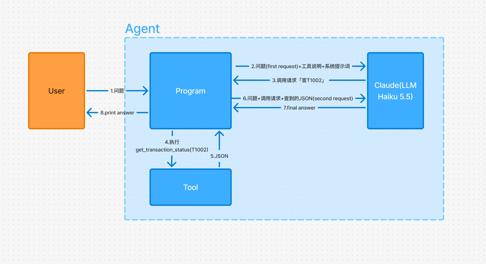

# bank-agent

这是一个模拟银行智能客服助手的 agent 设计练习。它接入大语言模型，并能调用工具访问模拟数据库，帮用户解答常规的交易查询。

## 它怎么工作



用户在终端输入一个问题，程序把「问题 + 工具说明 + 系统提示词」一起发给 LLM。LLM 返回调用工具的请求，程序执行 `get_transaction_status(交易编号)`，拿到 JSON 结果后，连同问题、调用请求等一并再发给 LLM。LLM 返回最终答案给程序，程序把答案打印给用户。

## 怎么运行

1. 下载代码，安装 Node.js 22 或以上，以及 VS Code（编辑代码用）。
2. 在项目目录执行 `npm install`。
3. 在项目根目录新建 `.env` 文件，写入你自己的密钥：`ANTHROPIC_API_KEY=你的密钥`。`.env` 已在 `.gitignore` 里，不会被提交。如果你需要通过代理才能连上 API，再加一行 `PROXY_URL=你的代理地址`（例如 `http://127.0.0.1:7897`）；不需要代理就不写。
4. 运行，命令后面跟一整句问题：

   ```bash
   npm run agent -- "我的交易 T1002 现在是什么状态？"
   ```

## 能做什么，不能做什么

目前只有 `get_transaction_status()` 一个工具，agent 只支持查询交易的进度状态、金额、交易对象和日期，不回答其他无关问题（比如天气）。

每次运行只回答一个问题，不记得上一次问了什么；它只能查，不能转账或做任何修改。

## 设计决定

- **统一用简体中文回复**：无论用户用什么语言提问，agent 都用简体中文回答。
- **查不到**：工具正常返回「没有这笔交易」时，如实告知用户没有这笔交易，再建议用户核对编号。
- **出错**：查询工具出错时，并不知道交易存不存在，所以不说「不存在」，而是回复用户「暂时查不了，请稍后再试」。
- **最多跑 5 轮**：防止无限循环调用工具。

## 测试

1. 正常查询：`我的交易 T1002 现在是什么状态？`
2. 查不到的 ID：`T9999 那笔怎么了？`
3. 无关问题：`今天伦敦天气怎么样？`
4. 工具出错：`帮我查一下 T5000`（`src/agent.ts` 里模拟超时）

每条怎么算通过，见 [`tests/cases.md`](tests/cases.md)。现在是手动运行，2026-11-12 那次 4 条全部通过。
